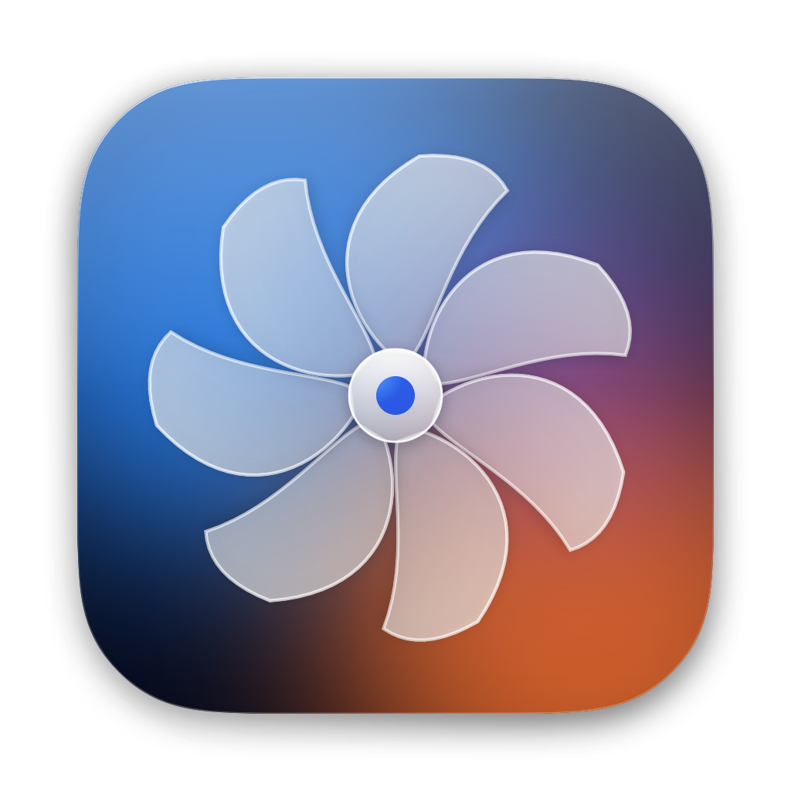
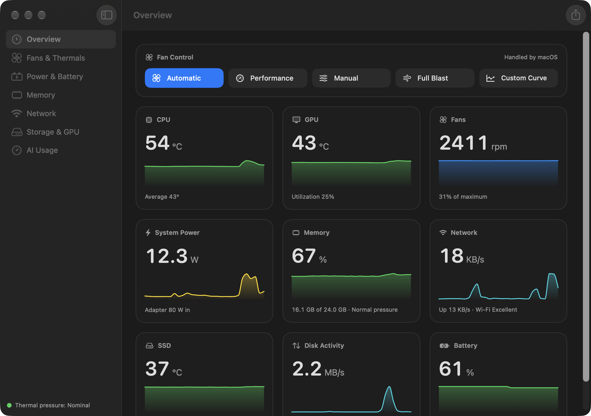
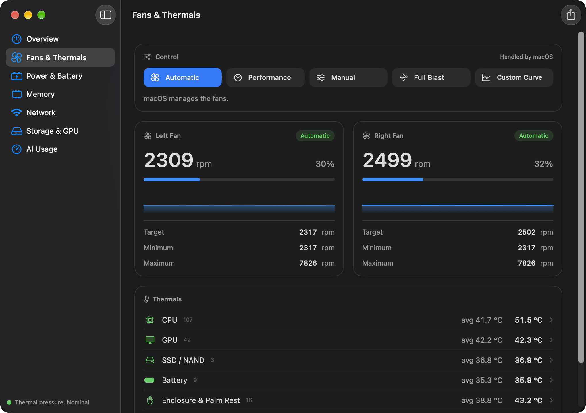
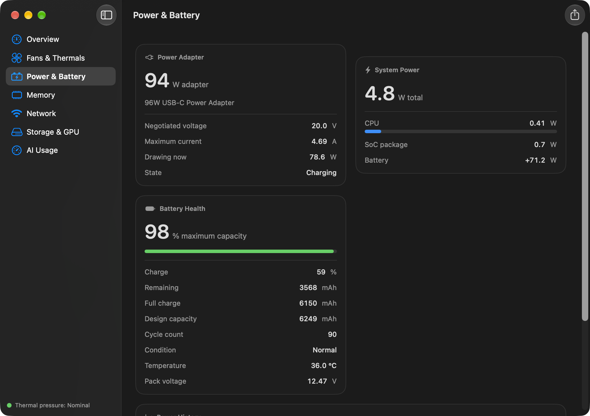
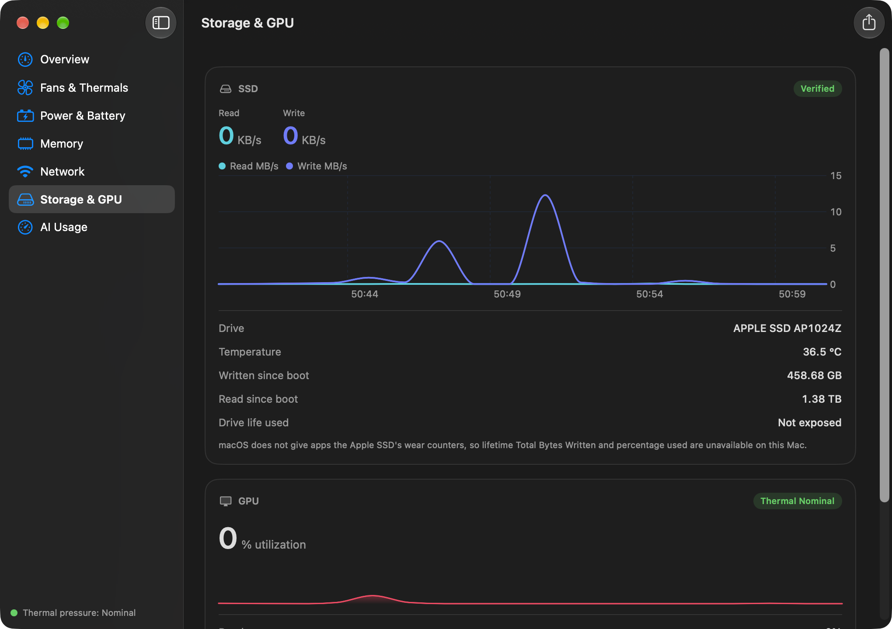

<p align="center">
  
</p>

<h1 align="center">Zephyr</h1>

<p align="center">Native fan control and hardware monitoring for macOS, in the menu bar.<br>
Swift and SwiftUI, no third-party libraries.</p>



## Features

**Fan control**
- **Automatic:** macOS manages the fans.
- **Performance:** a smooth ramp between 45 °C and 80 °C.
- **Manual:** a slider and numeric entry, with synced or per-fan control and trackpad haptics.
- **Full Blast:** every fan at its maximum.
- **Custom Curve:** drag points to map CPU, GPU or SSD temperature to fan speed.
- **Safety override:** if a core sensor reaches 95 °C while you control the fans, they go to maximum and you get a notification.

**Monitoring**
- **Fans and thermals:** current, minimum, maximum and target RPM; CPU, GPU, SSD, battery and enclosure temperatures.
- **Power and battery:** adapter wattage, voltage and current; system and CPU power; battery capacity, cycle count and condition.
- **Memory:** a breakdown like Activity Monitor's, the biggest users, and suggestions for reducing use.
- **Network:** live download and upload speeds, Wi-Fi signal, link speed and channel.
- **Storage and GPU:** read and write throughput, SMART status and GPU utilization.
- **AI usage (optional, off by default):** remaining Codex, Claude and Gemini allowance.

**Everyday use**
- Lives in the menu bar. The Dock icon appears only while a window is open.
- Global shortcuts: ⌃⌥⌘F cycles fan modes, ⌃⌥⌘A returns to Automatic, ⌃⌥⌘B selects Full Blast.
- Exports a hardware health snapshot as JSON.

## Screenshots

| Fans & Thermals | Power & Battery |
|---|---|
|  |  |



## What has been tested

| | |
|---|---|
| **Verified by the author** | MacBook Pro with M5 Pro (`Mac17,9`), macOS 27: sensor readings and all fan modes |
| **Builds, but untested** | Intel Macs, other Apple Silicon models, macOS 14 to 26 |

Sensor and fan keys differ between Mac models. Treat fan control on anything other than the verified model as experimental, and please open an issue with your model identifier.

## Requirements

- macOS 14 or later, Apple Silicon or Intel
- Xcode 26 or later to build
- An administrator password, once, to install the fan control helper

There is no prebuilt download yet, so you build it yourself.

## Build and install

```bash
git clone https://github.com/Farook-Sayed/Zephyr.git
cd Zephyr
xcodebuild -project Zephyr.xcodeproj -scheme Zephyr -configuration Release \
  -derivedDataPath build -destination 'generic/platform=macOS' build
cp -R build/Build/Products/Release/Zephyr.app /Applications/
```

No Apple developer account is needed: by default the app is signed to run locally. To sign with your own team, copy `Config/Local.xcconfig.example` to `Config/Local.xcconfig` and add your Team ID.

Reading sensors needs no privileges. Changing fan speed needs a small root helper:

```bash
scripts/install-helper.sh /Applications/Zephyr.app
```

Quit other fan utilities first, because two apps writing the same fan settings will fight. To remove the helper and return the fans to macOS:

```bash
scripts/uninstall-helper.sh
```

If you change `project.yml`, regenerate the Xcode project with [XcodeGen](https://github.com/yonaskolb/XcodeGen): `xcodegen generate`.

A read-only self-test prints one sensor sweep and never changes fan settings:

```bash
/Applications/Zephyr.app/Contents/MacOS/Zephyr --selftest
```

## How fan control stays safe

The app runs without privileges. Only the helper, which runs as root, writes fan settings, and it does nothing else.

- The helper checks the code signature of whatever connects to it.
- If the app quits, crashes or goes silent for 20 seconds, the helper hands the fans back to macOS.
- The helper enforces its own 95 °C limit, independently of the app.

**A limitation of locally signed builds:** without a developer Team ID, the helper can only check the app's identifier and location. Software that can replace the app on disk could then control your fans. Signing with your own team closes this.

## Privacy

Zephyr has no analytics and makes no network requests of its own. The health snapshot export leaves out your local IP address and network name, but it does include the names of the apps using the most memory.

The AI usage trackers are off until you switch them on. Zephyr does not read sign-in tokens.

| Provider | What Zephyr reads or runs |
|---|---|
| **Codex** | Limits recorded in `~/.codex/sessions`. *Check Codex Now*, or a first run with no logs, starts `codex app-server` once, which contacts OpenAI. |
| **Claude** | The cached usage figures in `~/.claude.json` (and the account ID, to match them). *Check Claude Now* runs the `claude` command line, which contacts Anthropic. |
| **Gemini** | Runs `agy -p /usage` (Antigravity CLI) every 10 minutes while enabled, which contacts Google. |

## Limitations

- It uses private macOS interfaces (the HID event system and IOReport) and undocumented SMC keys, which a macOS update can break.
- It cannot be distributed on the Mac App Store, because the sandbox blocks hardware access.
- SSD wear and lifetime bytes written are not available to apps on Apple SSDs.
- Apple does not label individual CPU core sensors on newer chips.
- On the M5 Pro, CPU power comes from SMC keys identified by testing, not from documentation.
- The Wi-Fi network name is hidden, because macOS only reveals it to apps with Location access.
- *Launch at login* and the in-app helper installer need a properly signed build and have not been verified. Use the script above.

## Project layout

| Path | Contents |
|---|---|
| `App/` | The SwiftUI app: sensors, fan control, views |
| `Helper/` | The root helper that writes fan settings |
| `Shared/` | SMC client and the app-to-helper protocol |
| `UsageRecorder/` | Small command-line recorder for Claude Code status-line data |
| `scripts/` | Build, release, and helper install scripts |
| `icon/` | App icon and the script that draws it |

## Disclaimer

Zephyr changes how your Mac is cooled. It is provided as is, without warranty, and you use it at your own risk.

Zephyr is an independent project. It is not affiliated with or endorsed by Apple, Anthropic, OpenAI, Google, CrystalIDEA (Macs Fan Control) or the Zephyr Project. Product names are trademarks of their respective owners.

## License

[MIT](LICENSE) © 2026 Farook Sayed
